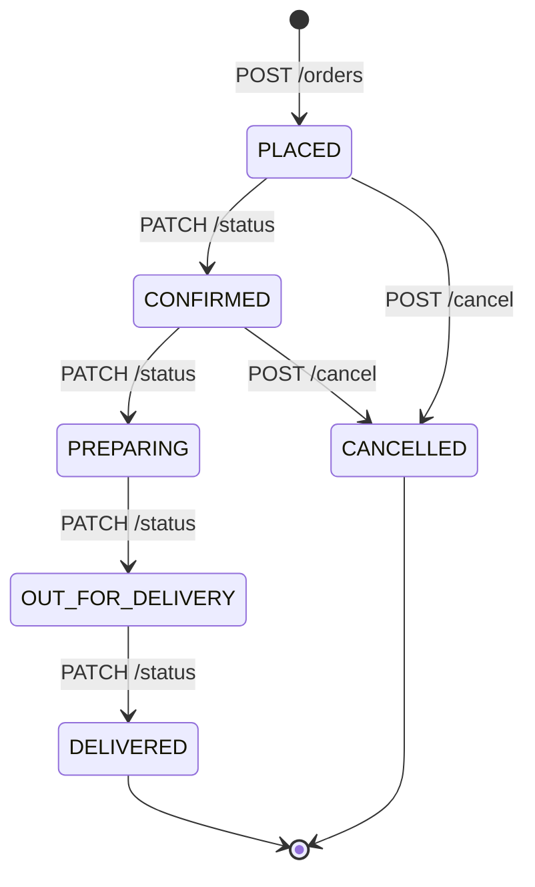

# Food Order Management API (Go)

A clean, production-grade RESTful backend in **Go** for a food-ordering service. Built entirely using the **Go Standard Library** (zero third-party dependencies) and Go 1.22+ pattern routing.

---

## 1. Overview & Architecture

The API allows clients to browse menu products, place food orders, retrieve orders, advance order statuses through an enforced lifecycle state machine, and cancel active orders.

### Key Architectural Characteristics
- **Standard Library ONLY**: Uses `net/http`, `encoding/json`, `sync`, `errors`, `time`, and `testing`. No web frameworks or third-party routers.
- **Go 1.22 Pattern Routing**: Direct method-based routing and wildcards (`GET /products/{id}`, `r.PathValue("id")`).
- **Thread-Safe In-Memory Storage**: Uses `sync.RWMutex` to protect internal maps with deep-copy encapsulation against concurrent data races.
- **Integer Currency Arithmetic**: Money is stored internally as integer **PAISE** (`14900` = ₹149.00). Floating-point math is strictly avoided for money calculations to eliminate binary rounding errors. Helper fields (`price_rupees`, `total_rupees`) provide user-friendly rupee amounts.
- **Strict Validation & Resiliency**: Enforces JSON schema with `DisallowUnknownFields()`, limits request bodies to 1 MB with `http.MaxBytesReader`, sets explicit server timeouts, and logs every request duration.

---

## 2. File Layout

```text
food-order-api/
├── main.go            # Entry point, dependency injection wiring, timeouts, starts server
├── models.go          # Domain models, enum constants, request/response structs, JSON tags
├── store.go           # Thread-safe in-memory store with sync.RWMutex and deep cloning
├── service.go         # Core business logic (pricing, item deduplication, lifecycle transitions)
├── handlers.go        # HTTP handlers, routing, logging middleware, centralized error handling
├── service_test.go    # Unit tests for models, store encapsulation, concurrency, and rules
├── handlers_test.go   # End-to-end HTTP integration tests with httptest
├── go.mod             # Go module definition (Go 1.22+)
└── README.md          # Project documentation
```

---

## 3. Prerequisites & Running

### Prerequisites
- **Go 1.22** or newer. Verify by running:
  ```powershell
  go version
  ```
  > **Tip:** If you just installed Go and your terminal says `go : The term 'go' is not recognized`, close and reopen your terminal (or run `$env:Path = [System.Environment]::GetEnvironmentVariable("Path","Machine") + ";" + [System.Environment]::GetEnvironmentVariable("Path","User")`) to load the updated system PATH.

### Running the Server
```powershell
go run .
```
The server will start listening on **`http://localhost:8080`**.

### Running Tests

**Standard Tests (Recommended for local dev):**
Runs all unit, state machine, and concurrent HTTP integration tests:
```powershell
go test -v ./...
```

**Static Analysis:**
```powershell
go vet ./...
```

**Race Detector (Optional):**
```powershell
go test -race ./...
```
> **Note for Windows users:** Go's race detector (`-race`) uses ThreadSanitizer, which requires CGO and a C compiler (GCC/MinGW-w64).
> - On Linux, macOS, and GitHub Actions CI, `-race` works out of the box.
> - On Windows without a C compiler, running `-race` will output `go: -race requires cgo`. For local testing, `go test -v ./...` is all you need.
> - If you want to run `-race` locally on Windows, install MinGW-w64 via PowerShell:
>   ```powershell
>   winget install -e --id BrechtSanders.WinLibs.POSIX.UCRT
>   ```
>   Then restart PowerShell and run with `$env:CGO_ENABLED="1"`.

---

## 4. Status Transition Lifecycle

Orders adhere to a strict forward-only finite state machine. `DELIVERED` and `CANCELLED` are terminal states.



### Transition Rules
- **Forward Progress:** `PLACED` $\to$ `CONFIRMED` $\to$ `PREPARING` $\to$ `OUT_FOR_DELIVERY` $\to$ `DELIVERED`.
- **Cancellation:** Allowed **only** from `PLACED` or `CONFIRMED`. Attempting to cancel an order in `PREPARING` or later returns `409 Conflict`.
- **Terminal States:** Orders in `DELIVERED` or `CANCELLED` cannot be changed. Attempting to transition from `DELIVERED` returns `409 Conflict`.

---

## 5. API Endpoints Table

| Method | Endpoint | Description | Success Code |
| :--- | :--- | :--- | :--- |
| `GET` | `/health` | Server health check | `200 OK` |
| `GET` | `/products` | List all menu products | `200 OK` |
| `GET` | `/products/{id}` | Get product details by ID | `200 OK` |
| `POST` | `/orders` | Place a new order (calculates prices & merges duplicates) | `201 Created` |
| `GET` | `/orders` | List all orders sorted by ID ascending | `200 OK` |
| `GET` | `/orders/{id}` | Get specific order by ID | `200 OK` |
| `PATCH` | `/orders/{id}/status` | Advance order status forward | `200 OK` |
| `POST` | `/orders/{id}/cancel` | Cancel an order (from PLACED or CONFIRMED) | `200 OK` |

---

## 6. Sample Requests & Responses

### 1. Health Check
**Request:**
```bash
curl http://localhost:8080/health
```
*(Or PowerShell: `irm http://localhost:8080/health`)*

**Response (200 OK):**
```json
{
  "status": "ok"
}
```

---

### 2. List Products
**Request:**
```bash
curl http://localhost:8080/products
```

**Response (200 OK):**
```json
[
  {
    "id": 1,
    "name": "Veg Burger",
    "price_paise": 14900,
    "price_rupees": 149,
    "available": true
  },
  {
    "id": 2,
    "name": "French Fries",
    "price_paise": 9900,
    "price_rupees": 99,
    "available": true
  },
  {
    "id": 3,
    "name": "Cold Coffee",
    "price_paise": 12000,
    "price_rupees": 120,
    "available": true
  },
  {
    "id": 4,
    "name": "Chocolate Brownie",
    "price_paise": 8000,
    "price_rupees": 80,
    "available": false
  }
]
```

---

### 3. Get Single Product
**Request:**
```bash
curl http://localhost:8080/products/1
```

**Response (200 OK):**
```json
{
  "id": 1,
  "name": "Veg Burger",
  "price_paise": 14900,
  "price_rupees": 149,
  "available": true
}
```

**Error cases:**
- `GET /products/999` $\to$ `404 Not Found`: `{"error": "resource not found"}`
- `GET /products/abc` $\to$ `400 Bad Request`: `{"error": "product id must be an integer"}`

---

### 4. Create Order
**Request:**
```powershell
irm -Method Post http://localhost:8080/orders -ContentType "application/json" -Body '{"items":[{"product_id":1,"quantity":2}]}'
```
*(Or `curl.exe -X POST http://localhost:8080/orders -H "Content-Type: application/json" -d '{"items":[{"product_id":1,"quantity":2}]}'`)*

**Response (201 Created):**
```json
{
  "id": 1,
  "items": [
    {
      "product_id": 1,
      "name": "Veg Burger",
      "quantity": 2,
      "unit_price_paise": 14900,
      "unit_price_rupees": 149
    }
  ],
  "status": "PLACED",
  "total_paise": 29800,
  "total_rupees": 298,
  "created_at": "2026-10-23T12:00:00Z"
}
```

**Business Rules Validated:**
- Automatically merges duplicate `product_id`s in request into a single item with combined quantity.
- Unit prices are populated exclusively from stored products (client-submitted prices are ignored).
- Rejects empty items list (`400 Bad Request`).
- Rejects quantity $< 1$ (`400 Bad Request`).
- Rejects unavailable products (`400 Bad Request`).
- Rejects non-existent products (`404 Not Found`).
- Rejects unknown JSON fields (`400 Bad Request`).

---

### 5. List Orders
**Request:**
```powershell
irm http://localhost:8080/orders
```

**Response (200 OK):**
```json
[
  {
    "id": 1,
    "items": [
      {
        "product_id": 1,
        "name": "Veg Burger",
        "quantity": 2,
        "unit_price_paise": 14900,
        "unit_price_rupees": 149
      }
    ],
    "status": "PLACED",
    "total_paise": 29800,
    "total_rupees": 298,
    "created_at": "2026-10-23T12:00:00Z"
  }
]
```
*(Note: Returns an empty list `[]`, never `null`, when no orders exist).*

---

### 6. Get Order by ID
**Request:**
```powershell
irm http://localhost:8080/orders/1
```

**Response (200 OK):**
```json
{
  "id": 1,
  "items": [
    {
      "product_id": 1,
      "name": "Veg Burger",
      "quantity": 2,
      "unit_price_paise": 14900,
      "unit_price_rupees": 149
    }
  ],
  "status": "PLACED",
  "total_paise": 29800,
  "total_rupees": 298,
  "created_at": "2026-10-23T12:00:00Z"
}
```

---

### 7. Update Order Status
**Request:**
```powershell
irm -Method Patch http://localhost:8080/orders/1/status -ContentType "application/json" -Body '{"status":"CONFIRMED"}'
```

**Response (200 OK):**
```json
{
  "id": 1,
  "items": [ ... ],
  "status": "CONFIRMED",
  "total_paise": 29800,
  "total_rupees": 298,
  "created_at": "2026-10-23T12:00:00Z"
}
```

**Invalid transition example (e.g. from DELIVERED to PREPARING):**
```powershell
curl.exe -X PATCH http://localhost:8080/orders/1/status -H "Content-Type: application/json" -d '{"status":"PREPARING"}'
```
**Response (409 Conflict):**
```json
{
  "error": "invalid status transition: cannot transition from DELIVERED to PREPARING"
}
```

---

### 8. Cancel Order
**Request:**
```powershell
irm -Method Post http://localhost:8080/orders/1/cancel
```

**Response (200 OK):**
```json
{
  "id": 1,
  "items": [ ... ],
  "status": "CANCELLED",
  "total_paise": 29800,
  "total_rupees": 298,
  "created_at": "2026-10-23T12:00:00Z"
}
```

**Cancelling an order in PREPARING or DELIVERED:**
**Response (409 Conflict):**
```json
{
  "error": "invalid status transition: cannot cancel order in PREPARING status"
}
```

---

## 7. Error Handling Standard

All errors return the standardized format:
```json
{
  "error": "human readable message"
}
```
- `400 Bad Request`: Input validation failures, non-numeric IDs, unknown statuses, malformed JSON, or unknown fields.
- `404 Not Found`: Missing product or order.
- `409 Conflict`: Disallowed status transitions or cancellations of in-progress orders.
- `500 Internal Server Error`: Generic message protecting internal stack traces while logging actual errors server-side.

---

## 8. Future Work

To evolve this service into an enterprise-grade distributed system, the following enhancements are planned:
1. **PostgreSQL Persistence**: Replace the in-memory map with a relational database using `pgx` or `database/sql` with transactions to ensure persistence across restarts.
2. **Authentication & RBAC**: Integrate JWT/OAuth2 middleware to restrict `PATCH /orders/{id}/status` to kitchen and delivery staff roles.
3. **Pagination**: Implement cursor- or offset-based pagination (`?page=1&limit=20`) on `GET /orders` and `GET /products` for high scalability.
4. **Idempotency Keys**: Accept an `Idempotency-Key` header on `POST /orders` to prevent accidental duplicate orders caused by network retries.
5. **Docker Containerization**: Add a lightweight multi-stage `Dockerfile` based on `scratch` or `alpine` for minimal container image footprint.
